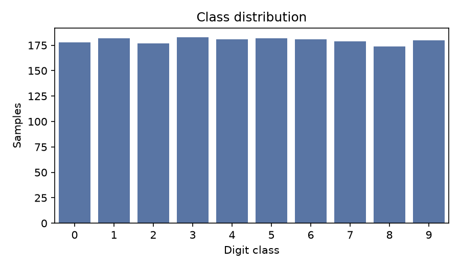
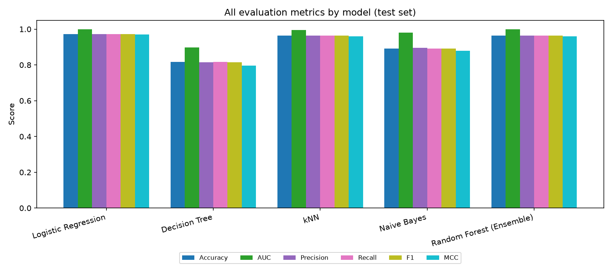
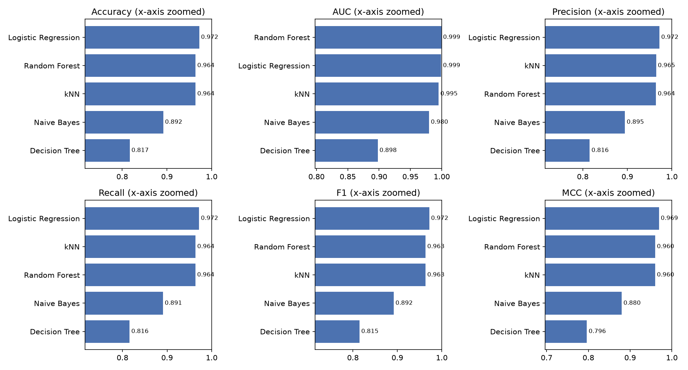
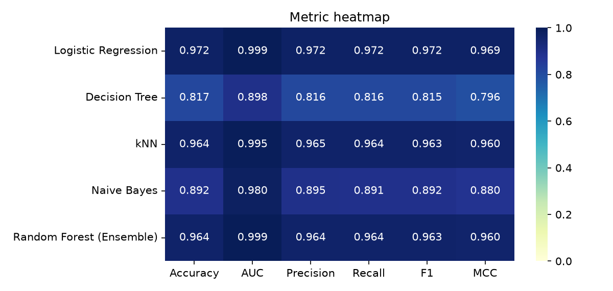
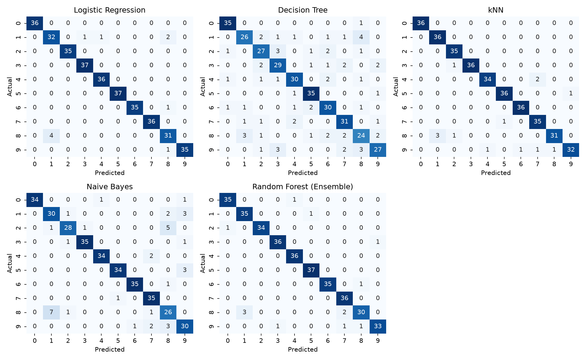

# ML Assignment 2 – Multi-class Classification with 5 ML Models

## Student details:
**Name** : Saswata bandyopadhyay  
**Bits ID** : 2026CT05022  
**Email** : 2026ct05022@wilp.bits-pilani.ac.in

## 1. Problem statement
Build and compare five classification models – Logistic Regression, Decision Tree, K-Nearest Neighbours, Gaussian Naive Bayes and Random Forest – on one public classification dataset, using the same preprocessing and the same train/test split, and evaluate each with Accuracy, AUC, Precision, Recall, F1 and Matthews Correlation Coefficient (MCC). The task here is to recognise which digit (0–9) is shown in a small handwritten-digit image.

## 2. Dataset description
| Item | Detail |
|---|---|
| Name | Optical Recognition of Handwritten Digits |
| Source | UCI Machine Learning Repository – https://archive.ics.uci.edu/dataset/80/optical+recognition+of+handwritten+digits |
| How it is loaded | `sklearn.datasets.load_digits` (scikit-learn bundles the 1,797-sample test portion of the UCI data; the full UCI file has 5,620 samples) |
| Instances / features | 1,797 rows, 64 features (assignment minimum: 1,000 / 12) |
| Features | `pixel_r_c`: intensity (integer 0–16) of each pixel of an 8×8 image; all numeric, no categorical features |
| Target | `target`: digit 0–9 (multi-class, 10 classes) |
| Class distribution | Almost perfectly balanced: 174–183 samples per class (max/min ≈ 1.05) |
| Missing values / duplicates | None found (checked in the notebook) |
| Why chosen | Satisfies the size requirements, is a true multi-class problem (so macro-averaged metrics and one-vs-rest AUC are needed), and has many correlated pixel features, which lets scale-sensitive, tree-based and probabilistic models be compared meaningfully |



## 3. GitHub repository link
https://github.com/saswata-bits/2026ct05022-ML-Assignment2

Repository contents: `ML_Assignment2.ipynb` (complete source code), `requirements.txt`, `README.md`, `test_data.csv` (the 360-row test set used in the experiments), `metrics.csv`, `cv_accuracy.csv`, `model/` (the five trained pipelines, `.joblib`), `images/` (charts used below).

## 4. How to run
```bash
pip install -r requirements.txt
jupyter notebook ML_Assignment2.ipynb      # then Kernel -> Restart & Run All
```
No internet connection is required (the data ships with scikit-learn). The notebook writes `test_data.csv`, `metrics.csv`, `cv_accuracy.csv`, `model/*.joblib` and `images/*.png` to its working directory.

## 5. Preprocessing
* Missing values: checked (0 found); a median `SimpleImputer` is kept in the pipeline as a safeguard.
* Duplicates: checked (0 found); `drop_duplicates()` is applied (no rows removed).
* Encoding: not needed – all features are numeric and the target is already integer-coded.
* Scaling: `StandardScaler` for all models (needed for Logistic Regression and kNN).
* Split: stratified 80:20 (1,437 train / 360 test), `random_state=42`; class proportions in train and test differ by at most 0.2 percentage points.
* No leakage: imputer and scaler are inside a scikit-learn `Pipeline`, so they are fitted on the training data only.

## 6. Models used and configuration
| Model | Configuration |
|---|---|
| Logistic Regression | `max_iter=2000`, default L2 penalty, `C=1.0` |
| Decision Tree | `max_depth=None`, `min_samples_leaf=1` (chosen by 5-fold CV on the training set) |
| kNN | `n_neighbors=5` |
| Naive Bayes (Gaussian) | `var_smoothing=0.1` (chosen by 5-fold CV on the training set) |
| Random Forest (ensemble) | `n_estimators=200` |

All use `random_state=42` where applicable. Hyperparameters for Naive Bayes and the Decision Tree were selected with `GridSearchCV` on the training data only; the test set was not used for any choice. Precision, Recall, F1 and AUC are **macro-averaged** (AUC is one-vs-rest).

### Comparison table (test set, 360 samples)
| ML Model Name            |   Accuracy |    AUC |   Precision |   Recall |     F1 |    MCC |
|:-------------------------|-----------:|-------:|------------:|---------:|-------:|-------:|
| Logistic Regression      |     0.9722 | 0.9991 |      0.9721 |   0.9719 | 0.9719 | 0.9692 |
| Decision Tree            |     0.8167 | 0.8978 |      0.8156 |   0.8159 | 0.8148 | 0.7965 |
| kNN                      |     0.9639 | 0.9950 |      0.9646 |   0.9637 | 0.9634 | 0.9600 |
| Naive Bayes              |     0.8917 | 0.9798 |      0.8947 |   0.8908 | 0.8918 | 0.8798 |
| Random Forest (Ensemble) |     0.9639 | 0.9992 |      0.9644 |   0.9635 | 0.9634 | 0.9600 |

### Graphs





### Robustness check – 5-fold cross-validated accuracy (all data)
| ML Model Name            |   CV accuracy mean |   CV accuracy std |
|:-------------------------|-------------------:|------------------:|
| Logistic Regression      |             0.9711 |            0.0037 |
| Decision Tree            |             0.8542 |            0.0154 |
| kNN                      |             0.9789 |            0.0063 |
| Naive Bayes              |             0.9037 |            0.0101 |
| Random Forest (Ensemble) |             0.9800 |            0.0054 |

## 7. Observations
| Model | Observation |
|---|---|
| Logistic Regression | Best on the test split: 97.2% accuracy, 10 errors, MCC 0.969, AUC 0.999. Scaled pixel features are close to linearly separable. Its most frequent mistake is true 8 predicted as 1 (4 times). Small gap between train (99.9%) and test accuracy. |
| Decision Tree | Weakest: 81.7% accuracy, 66 errors, AUC 0.898. It fits the training set perfectly (100%) but drops by ~18 points on test, i.e. it overfits; cross-validation did not find a depth limit that helps. Axis-aligned single-pixel splits suit image data poorly. |
| kNN | 96.4% accuracy, 13 errors, AUC 0.995. Same-digit images form tight clusters in pixel space. It has no real training step but prediction is the slower part (it compares against all stored training images). |
| Naive Bayes | 89.2% accuracy, 39 errors, but a high AUC (0.980): its probabilities rank classes well even though hard labels are worse. The independence assumption is violated because neighbouring pixels are strongly correlated. Cross-validation picked `var_smoothing=0.1`; it needs heavy smoothing, probably because some pixels have almost no variance. Frequent confusions: 8→1 and 2→8. |
| Random Forest | 96.4% accuracy, 13 errors, the highest AUC (0.9992) and the highest cross-validated accuracy (98.0%). Averaging many trees removes most of the single tree's variance (81.7% → 96.4%). It is the slowest model to train. |
| **Overall** | On the test split Logistic Regression is best by 3 errors (10 vs 13), but that gap is small: in 5-fold CV, Random Forest (98.0%) and kNN (97.9%) are slightly ahead of Logistic Regression (97.1%), with fold standard deviations of 0.4–0.6 points. So the top three are practically tied; Decision Tree and Naive Bayes are clearly behind. Logistic Regression is the simplest and fastest of the top group. |

## 8. Screenshot – execution on BITS Virtual Lab
<INSERT SCREENSHOT HERE: images/bits_lab_screenshot.png>
